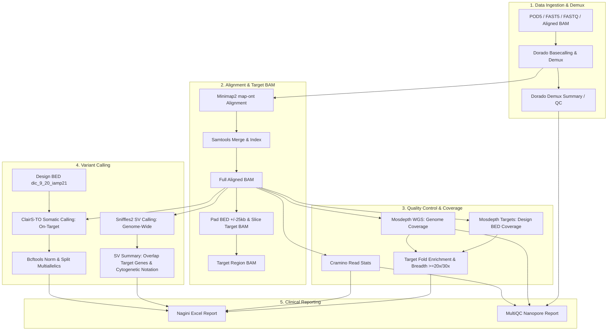

# Architecture Review & Roadmap: Nagini Adaptive Sampling, Genome-Wide CNV & Report Partitioning

**Repository:** `git@github.com:olawa/nagini.git`  
**Branch:** `main`  
**Date:** 2026-09-07  
**Reviewer:** Antigravity Bioinformatics Architecture Reviewer  
**Scope:** Adaptive sampling pipeline evaluation, BED file routing verification, whole-genome read-count CNV strategy (Rindels vs Hydra modules), and Excel report restructuring (SNPs, CNVs, SVs, Translocations).  
**Validation:** Unit test suites (94 tests in `workflow/scripts` + 44 tests in `pipeline_start_scripts` passing).

---

## 1. Executive Summary

| Dimension | Current Status | Assessment & Recommended Direction |
|---|---|---|
| **Adaptive Pipeline Maturity** | **Production-Ready** | Dorado SUP basecalling $\rightarrow$ Minimap2 $\rightarrow$ ClairS-TO target calling $\rightarrow$ Sniffles2 WGS SV calling $\rightarrow$ Mosdepth WGS + Target QC $\rightarrow$ Target-BAM ($\pm 25\text{ kb}$) $\rightarrow$ Excel/MultiQC reporting. |
| **BED Routing & Isolation** | **Good (Minor Fixes Needed)** | BED is correctly used to calculate target depth in `mosdepth_targets` and target BAM slicing in `target_bam`. `get_clairs_to_bed` needs explicit `sample_is_target_restricted()` checking so mixed runs (WGS + Adaptive) do not constrain WGS samples. `sv_summary.smk` must use `get_resolved_design_bed()`. |
| **Genome-Wide CNV Calling** | **Missing (High Priority)** | Currently no read-depth CNV caller is integrated. Whole-genome copy number (aneuploidy, arm gains/losses, *dic(9;20)*, *iAMP21*) requires binning reads across the **entire genome without target BED restriction**. |
| **CNV Engine Selection** | **Rindels vs Hydra** | **Rindels (`bin/rindels --only-cnv --ont`)** is strongly recommended as the primary engine: ultra-fast (Rust), native ONT read-count binning, ASCAT-like segmentation, purity/ploidy estimation, and ideogram generation. Hydra modules (`cnvpytor`, `cnvkit`) provide containerized reference alternatives. |
| **Excel Report Layout** | **Needs Partitioning** | Current report has `SNVs and indels`, `SVs`, and `Translocations`. Adding a dedicated **`CNVs`** sheet and organizing the results into the four clear genomic categories (**SNPs/Indels**, **CNVs**, **SVs**, **Translocations**) will align reporting directly with clinical hematology guidelines. |

---

## 2. Vad Adaptive Sampling-läget gör idag (End-to-End)



### Detaljerad genomgång av dagens steg:
1. **Routing & parametrar (`workflow/scripts/nagini_routing.py`)**:
   - `adaptive` definieras med `library_type: wgs`, `snv_calling: true`, `sv_calling: true`, `target_restricted: true`.
   - Minimap2-preset sätts till `map-ont`.
   - ClairS-TO felmodell härleds automatiskt från Dorado basecaller-modellen (t.ex. `dna_r10.4.1_e8.2_400bps_sup` $\rightarrow$ `ont_r10_dorado_sup_5khz_ssrs`).
2. **Referensgenom & Standard-BED**:
   - **hs1 / T2T**: `workflow/resources/adaptive/dic_9_20_iamp21_T2T.bed`
   - **hg38 / GRCh38**: `workflow/resources/adaptive/dic_9_20_iamp21_hg38.bed`
   - Innehåller målområden för *RUNX1 / iAMP21*, *PAX5*, *CDKN2A*, *chr9-p11*, *chr20*, *chr22*.
3. **Täckningsanalys (`mosdepth_genome` & `mosdepth_targets`)**:
   - WGS-täckning beräknas globalt för hela genomet.
   - Målregionstäckning beräknas per bas och per intervall i mål-BED.
   - Excel-rapporten beräknar `Target Fold Enrichment` ($\frac{\text{Mean Target Depth}}{\text{Mean WGS Depth}}$) samt `Target Breadth` ($\ge 20\times, \ge 30\times$) och listar lågtäckta målregioner (`<20x`).
4. **Målregions-BAM (`workflow/rules/target_bam.smk`)**:
   - Skapar automatiskt `alignment/target_bam/{sample}_{type}.target.bam` med $\pm 25\text{ kb}$ flanker runt panelens intervall.
5. **Variant-calling**:
   - **ClairS-TO**: Körs begränsat mot målpanelens BED-fil.
   - **Sniffles2**: Körs genom-vidt (WGS) för att inte missa stora translokationer och rearrangemang där en brytpunkt ligger utanför målregionen.
   - **`sv_summary.py`**: Filtrerar och annoterar SVs, detekterar translokationer (`BND`/`TRA`), kopplar brytpunkter till cytogenetiska band (`Start_Band`, `End_Band`, `Cytogenetic_Notation`) och märker upp vilka som träffar målgener.

---

## 3. Granskning av BED-filens användning (Coverage vs Variant Calling)

| Analyssteg | Nuvarande regel | Använder BED? | Rätt / Fel | Observationer & Åtgärder |
|---|---|---|---|---|
| **Måltäckning** | `mosdepth_targets.smk` | Ja (`get_resolved_design_bed`) | **Korrekt** | Räknar djup enbart över målregionerna. |
| **Helgenomstäckning** | `mosdepth_genome.smk` | Nej (ingen BED) | **Korrekt** | Ger global baslinje för helgenom. |
| **Target BAM Slicing** | `target_bam.smk` | Ja (`get_resolved_design_bed`) | **Korrekt** | Lägger till $\pm 25\text{ kb}$ flanker och mergar överlappande intervall via `pad_bed.py`. |
| **SNV/Indel Calling** | `clairs_to_call` (`Snakefile`) | Ja (`get_clairs_to_bed`) | **Behöver justeras** | Om `design_bed` finns i config skickas den till alla prover. Bör explicit kontrollera `if sample_is_target_restricted(wildcards.sample):` så att vanliga WGS-prover i blandade körningar inte begränsas till panelen. |
| **SV Calling** | `sniffles2_call` | Nej (helgenom) | **Korrekt** | Sniffles2 ska söka i hela BAM-filen för att identifiera translokationer till icke-målregioner. |
| **SV Annotering** | `sv_summary.smk` | Ja (`annotation_bed`) | **Behöver justeras** | Använder `config.get("reference", {}).get("design_bed", "")` direkt istället för `get_resolved_design_bed()`, vilket kan ge problem om sökvägen är relativ. |

---

## 4. Analys av helgenoms-CNV (Read-Count Binning)

### 4.1. Varför Target-BED inte ska användas för CNV
I adaptive sampling avvisas läsningar från icke-målregioner tidigt i poren, men genererar ändå en jämn bakgrundstäckning över hela genomet (ofta 2–5x vid standardkörning, eller högre vid hög yield).
* För att upptäcka **storskaliga kopietalsförändringar** (trisomier, monosomier, armförluster som 9p-deletioner vid *dic(9;20)*, eller amplifikationer av *chr21* vid *iAMP21*) måste man beräkna läsningsdensitet i **fönster/bins (t.ex. 50 kb, 100 kb eller 500 kb) över hela genomet**.
* **Viktig utmaning med Adaptive Sampling:** Målregionerna har 10–30x högre täckning än bakgrundsgenomet. Om fönsteranalysen inte hanterar detta kommer målregionerna att flaggas som kraftiga fokal-amplifieringar!
  - **Lösning:** Helgenoms-CNV-analysen ska beräkna kopietal över hela genomet, men **maskera eller flagga de kända målregionerna** så att de inte förvränger baslinjenormaliseringen eller rapporteras som falska fokal-amplifieringar.

### 4.2. Verktygsutvärdering: Rindels vs Hydra-moduler

```
                    ┌──────────────────────────────────────────────┐
                    │ Helgenoms-CNV från ONT Långa Läsningar      │
                    └──────────────────────┬───────────────────────┘
                                           │
                  ┌────────────────────────┴────────────────────────┐
                  ▼                                                 ▼
      ┌───────────────────────┐                         ┌───────────────────────┐
      │  Rindels (--only-cnv) │                         │  Hydra-Genetics CNV   │
      │  (In-house, Rust)     │                         │  (cnvpytor / cnvkit)  │
      └───────────┬───────────┘                         └───────────┬───────────┘
                  │                                                 │
      • Extremt snabb (sekunder/minuter)                • Standardiserade i Hydra
      • Native --ont långläsningsstöd                   • Singularity-containrar klara
      • Tar direkt BAM + Fasta                          • Flerstegsprocess (tyngre)
      • Producerar binnad BED + Parquet                 • Kräver germline VCF för BAF
      • Inbyggd ASCAT-lik segmentering                  • cnvkit ej optimerad för ONT
      • Genererar ideogram / PDF-rapport
```

| Egenskap | **Rindels (`bin/rindels --only-cnv --ont`)** | **Hydra CNVpytor (`cnvpytor.smk`)** | **Hydra CNVkit (`cnvkit.smk` - WGS)** |
|---|---|---|---|
| **Exekveringstid** | **Extremt snabb** (< 2 minuter för 30x ONT) | Måttlig (15–30 minuter) | Måttlig (10–20 minuter) |
| **Indata-krav** | Endast BAM + Referens FASTA | BAM + Fasta + Kräver VCF för BAF | BAM + Fasta + Normal ref |
| **Långläsnings-anpassning** | Skapad specifikt för ONT/HiFi (`--ont`) | Stödjer ONT read-depth | Ursprungligen hybrid-capture |
| **Segmentering** | ASCAT-lik kopietals- & BAF-segmentering | Mean-shift partitionering | Circular Binary Segmentation (CBS) |
| **Outputformat** | `.bed`, `.parquet`, ideogram / PDF-rapport | `.vcf`, `.pytor`, Manhattan PNG | `.cns`, `.cnr`, `.vcf` |
| **Integration i Nagini** | Binär finns redan i repomiljön (`bin/rindels`) | Finns som vendor-modul | Finns som vendor-modul |

**Rekommenderad strategi:**
1. Integrera en regel `cnv_rindels` som körs för alla WGS- och Adaptive-prover när `cnv_calling: true`.
2. Låt regeln producera en standardiserad TSV/BED (`cnv/{sample}_{type}.cnv_segments.tsv` eller `.vcf.gz`).
3. Låt regeln maskera eller annotera adaptive target-regioner med `TARGET_ENRICHED` så att de särskiljs från äkta somatiska CNVs.
4. Behåll Hydra `cnvpytor` som ett konfigurerbart alternativ för miljöer där endast Docker-containrar tillåts.

---

## 5. Strukturering av Excel-rapporten (4 Variantkategorier)

Användaren efterfrågar en tydlig uppdelning av resultaten i **SNPs**, **CNVs**, **SVs** och **Translokationer**.

### 5.1. Föreslagen arkitektur för flikar i Excel

```
Workbook: {sample}_{type}.nagini_report.xlsx
├── 1. Overview             (Översikt, QC, Target Enrichment, Sammanfattning av alla 4 klasser)
├── 2. SNPs and indels      (Småvarianter från ClairS-TO/Mutect2 med ClinVar, gnomAD_AF, VEP)
├── 3. CNVs                 (Helgenoms-CNV: kromosom, start, slut, kopietal, log2, status, gener)
├── 4. SVs                  (Fokala intra-kromosomala SVs: DEL, DUP, INS, INV från Sniffles2)
├── 5. Translocations       (Inter-kromosomala rearrangemang, breakends med cytogenetisk notation)
├── 6. WGS coverage         (Mosdepth global fördelning)
├── 7. Target coverage      (Mosdepth target fördelning per målregion)
└── 8. Cramino QC           (Lässtatistik, längdfördelning, baskvalitet)
```

### 5.2. Kolumner och innehåll per variantflik

#### Flik 2: `SNPs and indels`
* **Källa:** ClairS-TO / Mutect2 postprocess (`.filtered.norm.vcf.gz`).
* **Kolumner:** `Chrom`, `Position`, `Ref`, `Alt`, `Gene`, `Consequence`, `HGVSc`, `HGVSp`, `ClinVar_Significance`, `ClinVar_RevStat`, `gnomAD_AF`, `VAF`, `Depth`, `Alt_Reads`, `Filter`.

#### Flik 3: `CNVs` (NY)
* **Källa:** Rindels CNV / CNVpytor segments (`.cnv_segments.tsv`).
* **Kolumner:** `Chrom`, `Start`, `End`, `Length_kb`, `Copy_Number`, `Log2_Ratio`, `Event_Type` (LOSS, GAIN, AMP, NEUTRAL), `Ploidy_Baseline`, `Overlapping_Genes`, `Cytoband`, `Is_Target_Region` (TRUE/FALSE).

#### Flik 4: `SVs` (Intra-kromosomala)
* **Källa:** Sniffles2 SVs där `svtype in [DEL, DUP, INS, INV]` och samma kromosom (`chrom == chrom2` eller ingen `chrom2`).
* **Kolumner:** `Chrom`, `Start`, `End`, `SV_Type`, `Length_bp`, `QUAL`, `FILTER`, `Overlapping_Genes`, `Cytogenetic_Notation`, `Start_Band`, `End_Band`.

#### Flik 5: `Translocations` (Inter-kromosomala / Breakends)
* **Källa:** Sniffles2 SVs där `svtype in [BND, TRA]` eller `chrom != chrom2`.
* **Kolumner:** `Chr1`, `Pos1`, `Band1`, `Chr2`, `Pos2`, `Band2`, `SV_Type`, `Cytogenetic_Notation` (t.ex. `t(9;22)(q34;q11)`), `Genes_Spanned`, `Support_Reads`, `FILTER`.

---

## 6. Översikt över funktioner att lägga till (Roadmap)

1. **Buggrättningar i BED-hantering:**
   - Uppdatera `get_clairs_to_bed` i `common.smk` att kontrollera `sample_is_target_restricted(wildcards.sample)`.
   - Säkerställ att `sv_summary.smk` anropar `get_resolved_design_bed()`.
2. **Implementera Helgenoms-CNV:**
   - Lägg till regel `cnv_rindels` (eller `cnv_wgs`) i `workflow/rules/cnv.smk`.
   - Lägg till `--only-cnv --ont --cnv-bin-size 50000` i Rindels-anropet.
   - Skapa ett parsningssteg som genererar `reports/cnv/{sample}_{type}.cnv.tsv` och maskerar kända target regions.
3. **Uppdatera Excel-rapporten (`nagini_report.py`):**
   - Lägg till inläsning av `reports/cnv/{sample}_{type}.cnv.tsv`.
   - Skapa fliken `CNVs`.
   - Uppdela `SVs` så att rena translokationer (`BND`/inter-kromosomala) hamnar i `Translocations` och intra-kromosomala i `SVs`.
   - Lägg till ett dedikerat CNV-block i `Overview`-fliken.
4. **Framtida förbättringar för Adaptive Sampling:**
   - **Fasning & Haplotyper:** Integrera LongPhase eller WhatsHap för att se om mutationer och deletioner i målgener (t.ex. *PAX5*, *CDKN2A*, *TP53*) är bi-allelliska (compound heterozygous) eller på samma allel.
   - **Metylering (5mC):** Extrahera CpG-metylering i målpromotorer från Dorado-tags (`MM`/`ML`) via `modkit`.
