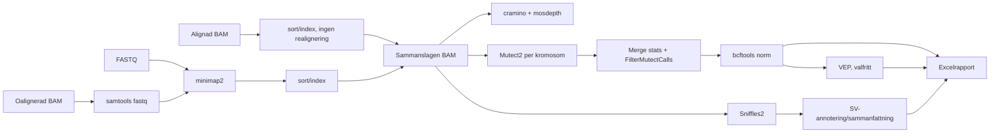

# Pipelineöversikt

Hydra-reglerna används för minimap2-index, alignment och sammanslagning, coverage, Mutect2 och
dess filtrering, ClairS-TO, DeepVariant, Sniffles2, SAVANA, normalisering, VEP, SnpEff, komprimering/indexering
och MultiQC. Lokala regler hanterar Dorado, Rindels, BCR-ABL1, CNV-rapporten, de tre inputvägarna,
SV-sammanfattningen och Excelrapporten (se [verktyg och regler](softwares.md)). Regelgrafen finns som
[`images/rulegraph.svg`](../images/rulegraph.svg) och i källformat som
[`workflow/rulegraph.dot`](../workflow/rulegraph.dot).
