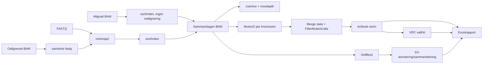

# Pipelineöversikt

Hydra-reglerna används för minimap2-index, coverage, Mutect2, Sniffles2,
komprimering/indexering, annotering och MultiQC. Lokala regler hanterar de tre
inputvägarna, filtrering och normalisering av Mutect2-resultat, VEP-kopplingen,
SV-sammanfattningen och Excelrapporten. Den genererade regelgrafen finns i
[`workflow/rulegraph.dot`](../workflow/rulegraph.dot).
