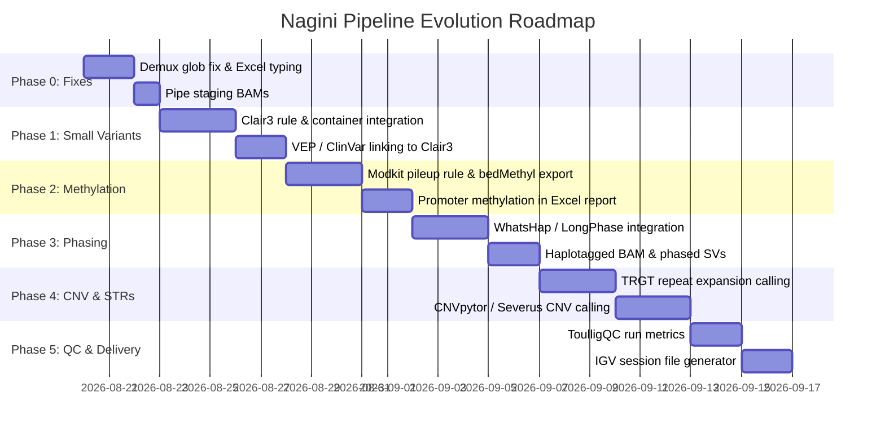

# Nagini Code Review & Pipeline Capability Assessment

## 1. Review scope

- **Repository:** `nagini` (CGU Oxford Nanopore analysis pipeline)
- **Branch / Commit:** `main` (commit `addfc5e` + working tree updates for Dorado MinKNOW staging)
- **Date:** 2026-08-19
- **Reviewer:** Antigravity Code Review
- **Goal:** Comprehensively review what the pipeline can do today, evaluate code correctness, performance, architecture, and bioinformatics suitability for Oxford Nanopore sequencing data, and identify essential missing features and a roadmap for additions.
- **Files/Modules included:**
  - `workflow/Snakefile`
  - `workflow/rules/common.smk`
  - `workflow/rules/dorado.smk`
  - `workflow/rules/stage_dorado_bam.smk`
  - `workflow/rules/stage_aligned_bam.smk`
  - `workflow/rules/minimap2_fastq_align.smk`
  - `workflow/rules/minimap2_unmapped_bam_align.smk`
  - `workflow/rules/samtools.smk`
  - `workflow/rules/mosdepth_genome.smk`
  - `workflow/rules/mosdepth_targets.smk`
  - `workflow/rules/snv_postprocess.smk`
  - `workflow/rules/sv_summary.smk`
  - `workflow/rules/excel_report.smk`
  - `workflow/rules/copy_results.smk`
  - `workflow/scripts/nagini_report.py`
  - `workflow/scripts/sv_summary.py`
  - `pipeline_start_scripts/start_nagini.sh`
  - `pipeline_start_scripts/prepare_nagini_inputs.py`
  - `config/config.yaml`, `config/output_files.yaml`, site configs and schemas
- **Files/Modules excluded:** Vendored submodules (`vendor/hydra-genetics/*`, `vendor/snakemake-wrappers/*`) except their integration boundaries.
- **Test validation:** Ran existing unit tests (`pipeline_start_scripts/test_prepare_nagini_inputs.py`, `workflow/scripts/test_nagini_report.py`, `workflow/scripts/test_sv_summary.py`) with 9/9 tests passing in Python 3.14. Dry-run verified against integration test configs.
- **Methodology:** Static code audit, data flow analysis, and bioinformatics validation for Oxford Nanopore Technologies (ONT) sequencing.

---

## 2. Executive summary

Nagini is a modular, Hydra-Genetics-compliant Snakemake pipeline tailored for Oxford Nanopore Technologies (ONT) sequencing data. It provides an end-to-end path from raw data (MinKNOW/POD5, FASTQ, or unmapped/aligned BAM) to alignments, QC summaries, structural variant calls (Sniffles2), small variant calls (Mutect2), and an Excel workbook summary.

### Status Scale
**Needs targeted fixes** (Strong foundational framework and reporting, but critical bioinformatics gaps exist for ONT small variant calling, phasing, methylation, and CNV analysis).

### Top Risks & Findings
1. **Mutect2 as the primary/sole SNV/Indel caller on ONT data (Correctness/Bioinformatics Risk - High):** GATK Mutect2 is designed for short-read Illumina data and somatic/mitochondrial error models. It struggles with ONT homopolymer indels and systematic basecalling noise. A dedicated neural caller (e.g., **Clair3** for germline or **ClairS** for somatic) is essential.
2. **Untapped ONT Modalities: Methylation & Phasing (Feature Gap - High):** While MM/ML tags are retained through alignment, no downstream rule processes 5mC/5hmC methylation (e.g., using `modkit`). Furthermore, long-read phasing (e.g., `WhatsHap` or `LongPhase`) is absent, leaving megabase-scale phase blocks and haplotyping untapped.
3. **Absence of Dedicated CNV & Repeat Expansion Callers (Feature Gap - Medium):** The pipeline lacks dedicated CNV calling (e.g. `CNVpytor` or `Severus`) and Short Tandem Repeat (STR) expansion calling (e.g. `TRGT` or `Straglr`), which are prime use cases for long-read clinical sequencing.
4. **Barcode Globbing Substring Collision in `dorado.smk` (Correctness - Medium):** In `dorado.smk`, `find "$raw" -type f -iname "*${barcode}*.bam"` can match substrings if non-zero-padded barcodes (e.g., `barcode1` matching `barcode10.bam`) are present.
5. **Excel Report Numeric String Typing (Usability - Low):** Several numeric fields (`Depth`, `VAF`, `Quality`) are passed as strings to the Excel generator, preventing native Excel numeric sorting and filtering.

---

## 3. Source inventory table

| File | Lines | Layer | Major Responsibility | Status | Notes |
|---|---:|---|---|---|---|
| `workflow/Snakefile` | 316 | Workflow DAG | Imports modules, wires rules to Hydra modules, defines `rule all` | Production | Clean Hydra module bindings |
| `workflow/rules/common.smk` | 394 | Pipeline Core | Config templating, sample/unit parsing, wildcard constraints, helper functions | Production | Robust placeholder expansion |
| `workflow/rules/dorado.smk` | 129 | Basecalling | Containerized Dorado basecaller & demux for MinKNOW/POD5 | Production | Empty barcode BAM fallback handling |
| `workflow/rules/stage_dorado_bam.smk` | 46 | Alignment Staging | Injects Read Group SM tags and indexes pipeline Dorado BAMs | Production | Ensures GATK sample compatibility |
| `workflow/rules/stage_aligned_bam.smk` | 51 | Alignment Staging | Injects Read Group SM tags and indexes external aligned BAMs | Production | Avoids unnecessary realignment |
| `workflow/rules/minimap2_fastq_align.smk` | 47 | Alignment | Minimap2 alignment for FASTQ + samtools sort/index | Production | Passes RG and preset (`map-ont`) |
| `workflow/rules/minimap2_unmapped_bam_align.smk` | 49 | Alignment | `samtools fastq` (preserving MM,ML) + minimap2 alignment | Production | Preserves modification tags |
| `workflow/rules/samtools.smk` | 41 | BAM Merging | Merges multi-unit BAMs per sample/type with samtools | Production | Standard coordinate sort |
| `workflow/rules/mosdepth_genome.smk` | 40 | QC | Whole-genome windowed coverage using Mosdepth wrapper | Production | Configurable window size (`by`) |
| `workflow/rules/mosdepth_targets.smk` | 41 | QC | Target-region & per-base coverage with Mosdepth wrapper | Production | Driven by `reference.design_bed` |
| `workflow/rules/snv_postprocess.smk` | 203 | SNV Calling | `MergeMutectStats`, `FilterMutectCalls`, `bcftools norm`, `vep` | Production | GATK4 Mutect2 postprocessing |
| `workflow/rules/sv_summary.smk` | 50 | SV Analysis | Invokes `sv_summary.py` on Sniffles2 output | Production | TSV, JSON, and cytoband support |
| `workflow/rules/excel_report.smk` | 47 | Reporting | Compiles multi-sheet Excel report | Production | Calls `nagini_report.py` |
| `workflow/rules/copy_results.smk` | 55 | Output Staging | Compiles dynamic Hydra copy rules for final results | Production | Standard Hydra copy engine |
| `workflow/scripts/nagini_report.py` | 489 | Reporting Script | Zero-dependency XLSX generator (Pure Python OpenXML) | Production | Multi-sheet, auto-filter, cytoband ISCN |
| `workflow/scripts/sv_summary.py` | 249 | SV Script | Extracts BNDs/translocations, cytobands, BED overlap | Production | Compact JSON/TSV output |
| `pipeline_start_scripts/start_nagini.sh` | 391 | Launcher | CLI wrapper, site selection, inbox discovery, Snakemake launcher | Production | Supports `local`, `workstation`, `marvin` |
| `pipeline_start_scripts/prepare_nagini_inputs.py` | 637 | Input Preprocessor | Discovers samples, validates tables, generates `config.nagini.yaml` | Production | Supports Dorado `bam_pass` directories |

---

## 4. Architecture and data-flow

### Data Flow Diagram

```text
[ MinKNOW / POD5 ] ──> dorado_basecaller ──> dorado_demux ──> stage_dorado_bam ──┐
[ FASTQ ] ─────────────> minimap2_fastq_align ─────────────────────────────────────┤
[ Unmapped BAM ] ──────> samtools fastq (MM,ML) ──> minimap2_unmapped_bam_align ───┼──> samtools_merge_bam ──> alignment/nagini_bam/{sample}_{type}.bam
[ Aligned BAM ] ───────> stage_aligned_bam (RG injection, sort, index) ───────────┘
                                                                                               │
                                   ┌───────────────────────────────────────────────────────────┴───────────────────────────────────────────────────────┐
                                   │                                                           │                                                      │
                                   ▼                                                           ▼                                                      ▼
                            [ QC Branch ]                                               [ SV Branch ]                                          [ SNV Branch ]
                                   │                                                           │                                                      │
                       ┌───────────┴───────────┐                                               ▼                                                      ▼
                       │                       │                                     sniffles2_call                                      gatk_mutect2 (per chr)
                       ▼                       ▼                                               │                                                      │
                mosdepth_genome        mosdepth_targets                                        ▼                                                      ▼
               (WGS windowed)           (Target BED)                                     bgzip + tabix                                         bcftools_concat
                       │                       │                                               │                                                      │
                       ▼                       ▼                                               ▼                                                      ▼
                    cramino                per-base BED                                    sv_summary                                      MergeMutectStats
                       │                       │                                       (TSV, JSON, BND)                                               │
                       └───────────┬───────────┘                                               │                                                      ▼
                                   │                                                           │                                              FilterMutectCalls
                                   ▼                                                           │                                                      │
                                multiqc                                                        │                                                      ▼
                           (Combined HTML)                                                     │                                                bcftools norm
                                   │                                                           │                                                      │
                                   │                                                           │                                                      ▼
                                   │                                                           │                                              VEP / SnpEff (optional)
                                   │                                                           │                                                      │
                                   └───────────────────────────────────────────┬───────────────┴──────────────────────────────────────────────────────┘
                                                                               │
                                                                               ▼
                                                                     nagini_excel_report
                                                             ({sample}_{type}.nagini_report.xlsx)
```

### Layer Boundaries
- **Input & Basecalling Layer:** Accepts 4 distinct input types. Generates standard BAM files with valid Read Group headers (`@RG ID:... SM:... PL:ONT`).
- **Alignment Layer:** Normalizes all inputs into coordinate-sorted, indexed BAM files at `alignment/nagini_bam/{sample}_{type}.bam`.
- **Variant Calling Layer:**
  - SV: Handled via Hydra's `cnv_sv` module (Sniffles2).
  - SNV: Handled via Hydra's `snv_indels` module (GATK Mutect2 per chromosome) + local postprocessing rules.
- **Annotation & Reporting Layer:** Custom zero-dependency Python script generates multi-tab Excel reports combining all metrics, small variants, SVs, translocations, and coverage stats.

---

## 5. Hot-path identification

| Hot Path | Scale | File / Function | Risk | Evidence | Suggested Measurement / Mitigation |
|---|---:|---|---|---|---|
| Alignment stream | Per-read (~10-50M reads) | `minimap2_fastq_align.smk`, `minimap2_unmapped_bam_align.smk` | CPU / I/O saturation | Confirmed | Piping minimap2 directly into `samtools sort -@ {threads}` avoids temporary SAM files on disk. Verified optimal. |
| BAM Read Group Staging | Per-read | `stage_aligned_bam.smk`, `stage_dorado_bam.smk` | Temporary disk I/O | Confirmed | `samtools addreplacerg` writes `.with_rg.bam` before sorting. Pipe `addreplacerg -u - \| samtools sort` to save intermediate disk writes. |
| Mutect2 Per-Chr Calling | Whole Genome | `workflow/Snakefile` (lines 127-133) | Execution time / false positives | Confirmed | Splitting by chromosome helps parallel execution, but Mutect2 active region HMM is computationally heavy on noisy ONT reads. |
| SV Bed Intersect | Per-SV (~5k-50k records) | `workflow/scripts/sv_summary.py` (`overlapping_labels`) | $O(N \times M)$ linear scan | Likely | If large BEDs (>100k genes) are provided, nested iteration over list of tuples becomes quadratic. Use an interval tree or bisect. |

---

## 6. Correctness checklist

- [x] **Input Handling:** 4 distinct paths explicitly validated via `units.tsv` schema (`input_type`).
- [x] **Read Groups:** GATK Mutect2 requires `@RG SM:...`; explicit RG injection in `stage_aligned_bam` and `stage_dorado_bam` ensures Mutect2 does not crash on bare ONT BAMs.
- [x] **Coordinate Systems:** Left-normalization and multiallelic splitting performed via `bcftools norm -m -both --check-ref w`.
- [x] **Cytoband Lookup:** Tested and robust with chromosome prefix normalization (`chr1` vs `1`) and bisect search.
- [!] **Mutect2 on ONT:** Mutect2 expects Illumina Q-scores and error profiles. ONT basecalling error modes cause excessive false positive indel calls and skewed LOD scores unless calibrated with custom priors or replaced with Clair3.
- [!] **Dorado Demux File Match:** In `dorado.smk`, `find "$raw" -type f -iname "*${barcode}*.bam"` can match substrings when single-digit barcodes are used.

---

## 7. What the pipeline currently can do

Nagini is already a capable and well-structured pipeline. Specifically, it can:

1. **Process 4 Distinct Input Modes:**
   - **MinKNOW / POD5 directories:** Runs containerized Dorado basecalling (`--model`, `--kit`, GPU devices `cuda:all`) and demultiplexing inside the pipeline DAG.
   - **FASTQ files:** Direct minimap2 mapping with `-x map-ont`.
   - **Unmapped BAM files:** Preserves methylation tags (`-T MM,ML`) while extracting FASTQ and mapping.
   - **Aligned BAM files:** Retains existing mapping, injects missing sample `@RG` tags, sorts, and indexes without realignment.
2. **Barcode Demultiplexing & Metadata Ingestion:**
   - Automatically ingests Dorado `bam_pass/barcodeXX` directory trees via `--barcode-map` CSV/TSV mapping.
   - Merges multiple BAM units per sample into a single coordinate-sorted BAM.
3. **Quality Control & Metrics:**
   - Computes Nanopore read-length and quality metrics with `cramino` (yield, N50, median read length, Q-score distributions).
   - Computes windowed whole-genome coverage and target-region coverage with `mosdepth`.
   - Compiles combined multi-sample QC reports with `MultiQC` (`multiqc_longread`).
4. **Structural Variant Calling & Annotation:**
   - Calls SVs with `Sniffles2` (version 2.2), supporting tandem repeat annotations (`--tandem-repeats`).
   - Generates `.snf` files (for multi-sample joint calling) and compressed, indexed VCFs.
   - Produces compact TSV and JSON summaries, explicitly extracting translocations and breakends (`BND`, `TRA`).
   - Annotates SVs with UCSC cytobands and standard ISCN cytogenetic notation (e.g. `t(9;22)(q34.12;q11.23)`, `del(5)(q13q33)`).
5. **Small Variant Calling & Annotation:**
   - Runs GATK `Mutect2` split across chromosomes using Hydra's BED split.
   - Merges statistics (`MergeMutectStats`), applies filters (`FilterMutectCalls`), and left-normalizes multiallelics (`bcftools norm`).
   - Supports offline VEP annotation with custom ClinVar integration (`CLNSIG`, `CLNDN`, `CLNREVSTAT`) and legacy SnpEff.
6. **Consolidated Excel Reporting:**
   - Produces a multi-sheet Excel workbook (`.xlsx`) per sample using pure Python (zero external dependencies).
   - Sheets: **Overview**, **SNVs and indels**, **SVs**, **Translocations**, **WGS coverage**, **Target coverage**, **Cramino QC**.
7. **Multi-Environment Orchestration:**
   - Built on Hydra-Genetics framework.
   - Ready-to-run profiles for `local` execution, `workstation` (multicore + local GPU), and `marvin` (Slurm / DRMAA cluster).
   - Reference registry snapshots for data provenance.

---

## 8. What is missing & what should be added (Gap Analysis & Roadmap)

To become a complete, modern Oxford Nanopore pipeline for both clinical genetics and research, the following components should be added:

### Priority 1: High-Accuracy ONT Small Variant Calling (Clair3 / ClairS)
- **Why:** Mutect2 is not built for ONT error models. **Clair3** is the gold standard for germline ONT small variant calling (SNP accuracy >99.5%, indel accuracy >85-90% on R10.4.1 chemistry). For somatic/tumor data, **ClairS** or **Somatic-Clair3** should be used.
- **What to add:**
  - A `rules/clair3.smk` rule wrapping Clair3 with model selection based on ONT chemistry (e.g., `r1041_e82_400bps_sup_v430`).
  - Config toggle: `small_variant_caller: "clair3"` (with `"mutect2"` as legacy option).
  - VEP annotation seamlessly connected to Clair3 VCF.

### Priority 2: Native DNA Methylation Analysis (`modkit`)
- **Why:** ONT's biggest differentiator is native 5mC / 5hmC base modification detection without bisulfite treatment. Nagini already passes `MM,ML` tags into the BAM, but currently does nothing with them!
- **What to add:**
  - A `rules/modkit.smk` rule running `modkit pileup` to generate genome-wide and target-region `bedMethyl` files.
  - Optional `modkit dmr` for differential methylation between samples.
  - Summary sheet in `nagini_report.py` for promoter methylation of key genes (e.g. *MGMT*, *MLH1*, *BRCA1*, or target BED genes).

### Priority 3: Megabase Phasing & Haplotagging (`WhatsHap` or `LongPhase`)
- **Why:** Long reads span multiple heterozygous SNVs, allowing chromosomal phasing of variants, identifying compound heterozygotes, and resolving allele-specific methylation/expression.
- **What to add:**
  - `whatshap phase` / `longphase phase` to phase SNVs and indels.
  - `whatshap haplotag` / `longphase haplotag` to produce a haplotagged BAM (`HP` tag: H1 vs H2).
  - Feed phased VCF/BAM into Sniffles2 (`--phase`) and `modkit` (haplotype-resolved methylation).

### Priority 4: Short Tandem Repeat (STR) / Expansion Calling (`TRGT` or `Straglr`)
- **Why:** Repeat expansions (Huntington's *HTT*, ALS/FTD *C9orf72*, Fragile X *FMR1*, Friedreich's ataxia *FXN*, Myotonic dystrophy *DMPK*) cannot be resolved by short reads. ONT reads span entire expanded repeats.
- **What to add:**
  - Integration of `TRGT` (Tandem Repeat Genotyping Tool) or `Straglr` with a curated catalog of pathogenic human STR loci.
  - Dedicated "Repeat Expansions" tab in the Excel report highlighting allele repeat counts against pathogenic thresholds.

### Priority 5: Long-Read Copy Number Variation (CNV) Calling (`CNVpytor` or `Severus`)
- **Why:** Mosdepth gives raw coverage, and Sniffles2 calls focal deletions/duplications, but broad/arm-level CNVs and loss-of-heterozygosity (LOH) require a read-depth + BAF CNV caller.
- **What to add:**
  - `CNVpytor` for WGS germline CNVs, or `Severus` / `Spectre` for somatic/tumor long-read CNVs.
  - CNV segments VCF/TSV and integration into the Excel report.

### Priority 6: Nanopore Run QC (`NanoPlot` / `ToulligQC` / `pycoQC`)
- **Why:** Cramino gives BAM-level read length stats, but flowcell-level metrics (active pores over time, translocation speed, yield per channel, pore occupancy) are crucial for sequencing quality troubleshooting.
- **What to add:**
  - `ToulligQC` or `NanoPlot` rule parsing sequencing summary files (`sequencing_summary.txt`) or POD5/FASTQ.
  - Include summary plots in MultiQC.

### Priority 7: Somatic & Tumor-Normal Workflow Mode
- **Why:** For cancer genomics, ONT is increasingly used for paired Tumor-Normal sequencing.
- **What to add:**
  - Automatic Tumor-Normal pairing in `Snakefile` when `samples.tsv` / `units.tsv` defines `T` and `N`.
  - Somatic filtering in Sniffles2 (subtracting germline normal SVs).
  - Somatic small variant calling with ClairS or Mutect2 tumor-normal mode.

### Priority 8: Visualization & Delivery Artifacts
- **What to add:**
  - **IGV Session Generator:** Auto-create an `.xml` IGV session file pointing to BAM, BigWig coverage, Sniffles2 VCF, small variant VCF, and bedMethyl track.
  - **CRAM Output Option:** Provide optional conversion of final BAM to CRAM with reference compression to save 60–70% storage.

---

## 9. Findings and recommendations

### [High] Replace or augment Mutect2 with Clair3 for ONT Small Variant Calling
**Status:** Confirmed  
**File:** `workflow/rules/snv_postprocess.smk`, `workflow/Snakefile`  
**Category:** Correctness / Bioinformatics  
**Impact:** Mutect2 produces high false-positive rates for ONT indels and SNPs due to mismatch with ONT error models.  
**Evidence:**
```python
# workflow/rules/snv_postprocess.smk: lines 62-106
rule gatk_filter_mutect_calls:
    shell: "gatk FilterMutectCalls --reference {input.ref} --variant {input.vcf} ..."
```
**Why it matters:** Research and clinical decisions require accurate variant calling. ONT data requires machine-learning models trained specifically on Oxford Nanopore flowcells and basecallers (e.g. R10.4.1 SUP).  
**Suggested fix:** Add `rules/clair3.smk` using the official Clair3 container (`docker://hkubal/clair3:latest`). Allow setting `variant_caller: clair3` in `config.yaml`.  
**Behavior change:** Intentional upgrade to ONT-standard variant calling accuracy.

---

### [Medium] Barcode directory matching in `dorado.smk` can cause cross-sample collision
**Status:** Confirmed  
**File:** `workflow/rules/dorado.smk`  
**Line:** 112  
**Category:** Correctness  
**Impact:** Substring match in `find "$raw" -type f -iname "*${barcode}*.bam"` can merge reads from multiple barcodes if single-digit barcode identifiers are used (e.g. `barcode1` matching `barcode10.bam`).  
**Evidence:**
```bash
while IFS= read -r bam_file; do
    bam_files+=("$bam_file")
done < <(find "$raw" -type f -iname "*${barcode}*.bam" -print)
```
**Why it matters:** If un-padded barcodes are passed in custom configurations, reads from one sample could contaminate another.  
**Suggested fix:** Match exact path components or directories:
```bash
find "$raw" -type f \( -path "*/${barcode}/*.bam" -o -name "${barcode}.bam" -o -name "${barcode}_*.bam" \) -print
```
**Behavior change:** None for zero-padded barcodes; prevents contamination for un-padded names.

---

### [Medium] Add pipeline rules for DNA methylation extraction via `modkit`
**Status:** Confirmed  
**File:** `workflow/Snakefile`, `workflow/rules/`  
**Category:** Feature Gap / Bioinformatics  
**Impact:** 5mC/5hmC methylation data present in ONT BAMs is ignored.  
**Evidence:** `minimap2_unmapped_bam_align.smk` explicitly extracts `-T MM,ML`, and `units.tsv` tracks `methylation: Yes`, but no rule processes these tags.  
**Suggested fix:** Add `rules/modkit.smk` running `modkit pileup` to generate tabix-indexed `bedMethyl` files and add a promoter methylation overview to the Excel report.

---

### [Low] Convert numeric strings to numeric values in `nagini_report.py`
**Status:** Confirmed  
**File:** `workflow/scripts/nagini_report.py`  
**Lines:** 158-160, 263-270  
**Category:** Usability  
**Impact:** In the generated Excel report, columns like `Depth`, `Quality`, and `VAF` are written as inline strings instead of native numbers, preventing Excel numerical sorting and conditional formatting.  
**Evidence:**
```python
"Depth": sample_values.get("DP", info.get("DP", "")),
```
**Suggested fix:** Cast numeric values (`int` for Depth/Position, `float` for VAF/Quality) in `parse_small_variant_vcf` before passing to `table()`.

---

## 10. Prioritized implementation plan



### Phase Details

#### Phase 0: Hardening & Bug Fixes (Low Risk)
- Fix barcode matching regex in `workflow/rules/dorado.smk`.
- Optimize intermediate BAM piping in `stage_aligned_bam.smk` and `stage_dorado_bam.smk`.
- Cast numeric values to int/float in `workflow/scripts/nagini_report.py`.

#### Phase 1: Clair3 Integration (High Impact)
- Add `workflow/rules/clair3.smk` using `hkubal/clair3` container.
- Configure chemistry model presets in site configs (`r1041_e82_400bps_sup_v430`).
- Update `get_small_variant_report_vcf` in `common.smk` to support Clair3 output.

#### Phase 2: DNA Methylation via Modkit (High Impact)
- Add `workflow/rules/modkit.smk` running `modkit pileup --cpg --ref {ref} {input.bam} {output.bed}`.
- Generate `bedMethyl.gz` and `.tbi`.
- Add promoter region summary extraction in `nagini_report.py`.

#### Phase 3: Long-Read Phasing & Haplotagging
- Add `workflow/rules/whatshap.smk` (or `longphase.smk`).
- Phase Clair3 VCF -> Haplotag BAM -> Feed phased data into Sniffles2 and Modkit.

#### Phase 4: STR Expansion Calling & CNV Calling
- Add `rules/trgt.smk` with human pathogenic repeat catalog.
- Add `rules/cnvpytor.smk` for WGS copy number segmentation.
- Add dedicated sheets in `nagini_report.py` for STR expansions and CNVs.

#### Phase 5: Run QC & Visualization
- Integrate `ToulligQC` / `NanoPlot` for raw sequencing yield and pore QC.
- Add IGV XML session generator pointing to all final tracks.

---

## 11. Agent-ready prompt for next task

```text
Task: Integrate Clair3 as an alternative/primary small-variant caller and harden Dorado demux matching in Nagini.

Files to modify:
1. workflow/rules/dorado.smk: Change find command to exact folder/filename matching.
2. workflow/rules/clair3.smk (NEW): Add rule clair3_call using container docker://hkubal/clair3:v1.0.10.
3. workflow/Snakefile: Include rules/clair3.smk and wire to rule all / VEP annotation.
4. workflow/rules/common.smk: Update small-variant VCF resolution based on config["small_variant_caller"].
5. config/config.yaml & schemas: Add clair3 configuration block with model and platform parameters.
6. workflow/scripts/nagini_report.py: Ensure VAF calculation handles both FORMAT/AF and FORMAT/AD, and cast numeric fields to float/int.

Validation:
1. python3 -m unittest pipeline_start_scripts/test_prepare_nagini_inputs.py workflow/scripts/test_nagini_report.py workflow/scripts/test_sv_summary.py
2. snakemake --dry-run -s workflow/Snakefile --configfile .tests/integration/config/config.yaml
```
